# Knowledgebase

A study assistant that reads your own course material. I collected lecture notes, slide decks, PDFs and project reports from four years of computing science, scattered across Google Drive folders, and wanted one place to ask questions across all of them and get answers that point back to the exact slide or paragraph.

The platform connects a Google Drive (or SharePoint) account, indexes what that account can see, and answers in two modes. **Quick Search** returns a cited answer in seconds. **Deep Investigation** runs an agent (Hermes) over several documents through read-only tools and reports what the material establishes, what conflicts between sources, and what it does not say. Settled conclusions, such as which method a course recommends or what a project team decided, become **records** that are verified and kept with their evidence.

It is built as a multi-user system with permissions, so it also works for a team on shared drives: every member sees only what their own account can open, and every answer is bound to that.

Django 6.1 · PostgreSQL 17 with pgvector · Celery · HTMX · Tailwind v4 · Hermes Agent v0.22.1 (pinned) · MCP.

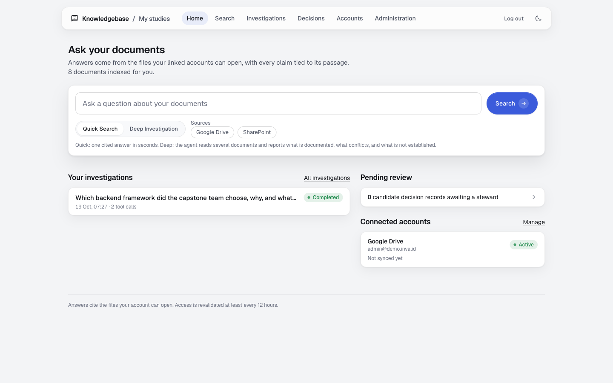

## What it does

| Function | How it works | Verified |
|---|---|---|
| Connect a drive | Link your own account (OAuth). The sync lists what the account can see, downloads Docs, Sheets, Slides, Word, Excel, PowerPoint, PDF, text and Markdown, then parses, chunks and embeds them. Audio, video and archives are recorded as metadata only. Access is revalidated every 12 hours. | Google Drive, live on a personal drive of about 3,000 items; SharePoint and OneDrive mock-tested (see below) |
| Quick Search | Hybrid retrieval (vector plus full text) over your visible documents, then one model call that writes claims bound to passages. Each claim carries the number of its source; a slide or page number is part of the citation. | Live |
| Deep Investigation | A Hermes agent gets one short-lived token and read-only tools. It searches, reads, cross-references, and returns statements with evidence ids. Statements whose evidence was not returned to that run are set apart as unsupported, never shown as findings. | Live, end to end through the web UI |
| Records | Passages from an answer or an investigation become a candidate record. A steward accepts it as draft, verifies it, or sends it back. A record is visible only when every passage behind it is visible to you. | Live |
| Administration | Document counts, access freshness, sync scopes, the change inbox, recent sync runs. | Live |
| Dark mode, keyboard, phone width | The theme follows the system and can be switched; every control is keyboard operable; pages stack at phone width. | Live |

The screenshots below come from the running app over a synthetic study corpus (`eval/corpus_academic/`: six lecture notes, a generated slide deck, a generated report). No real course material or personal file appears in this repository.

## Walkthrough

**Organizations and login.** Local accounts. A user can belong to several organizations; mine are "My studies" and a demo team.

| | |
|---|---|
| 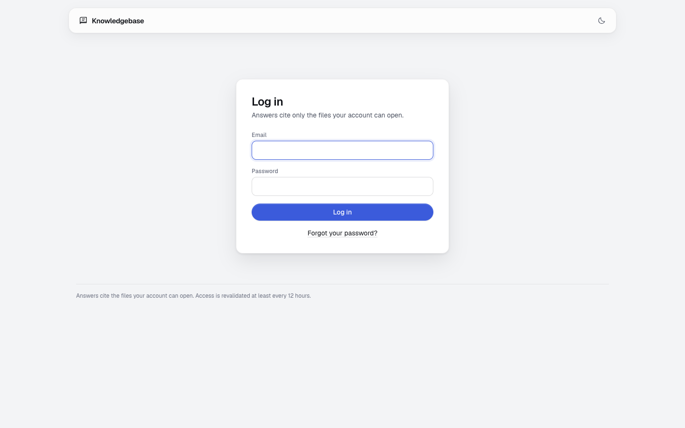 | 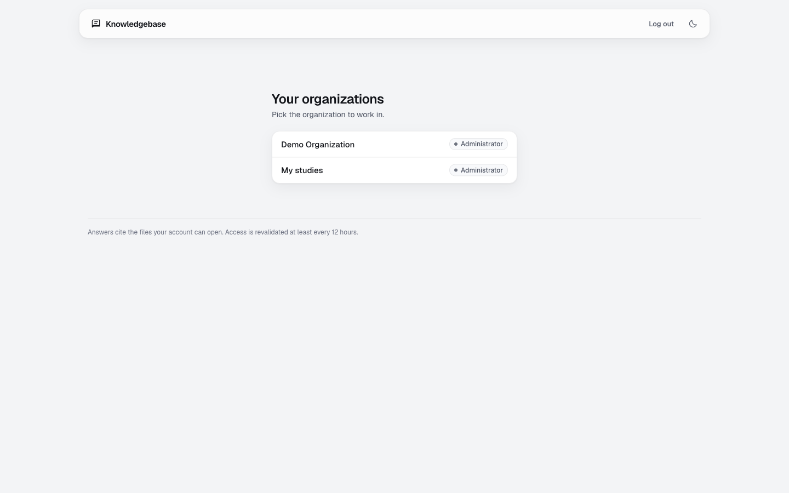 |

**Quick Search.** The answer's sentences carry numbered chips, the sources carry the same numbers, and a slide deck cites the slide. Hover or focus a sentence and its source lights up, and back.

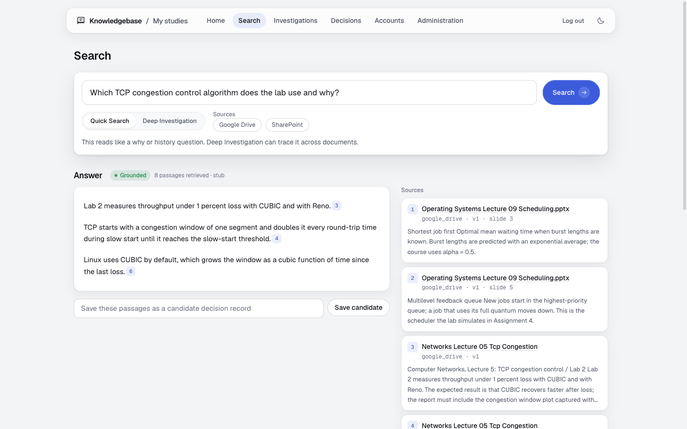

**Deep Investigation.** The agent runs in its own process with a budget of turns, tool calls, characters and time. The page polls while it runs and can cancel it.

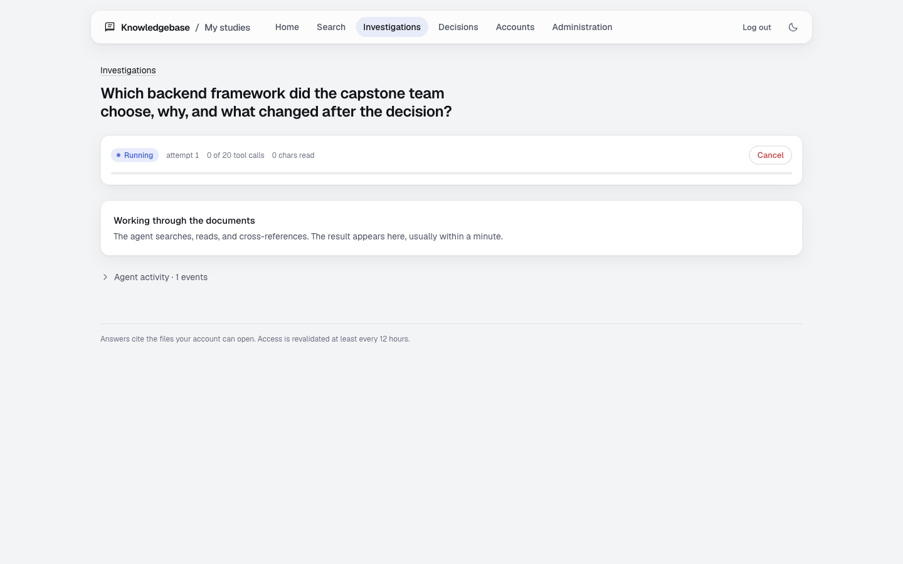

The result is built from validated statements only. Each one cites the passage it rests on. A statement the agent could not back with a returned passage is set apart at the bottom and labeled.

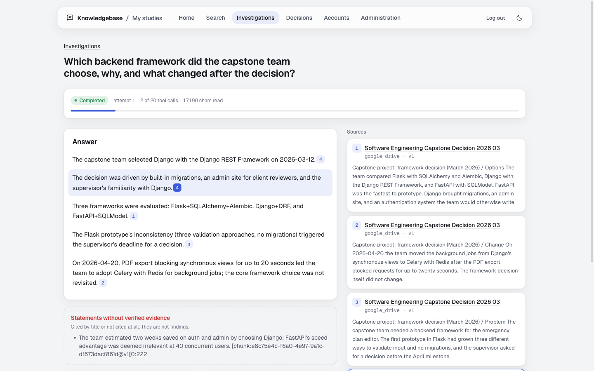

**Records.** A capstone decision from a project report, saved as a candidate, then verified. The timeline shows which stages the evidence establishes and which it does not.

| | |
|---|---|
| 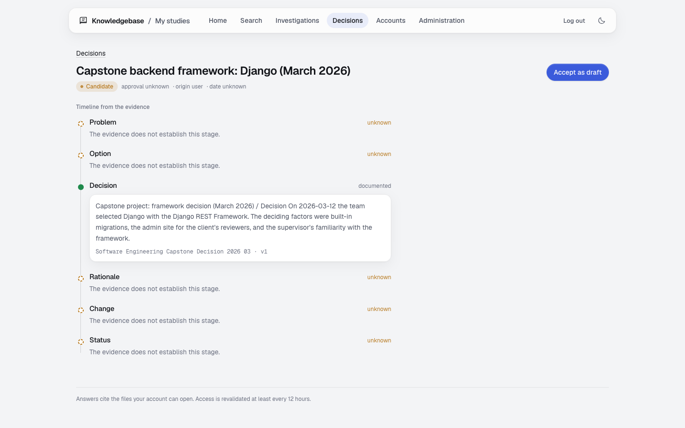 | 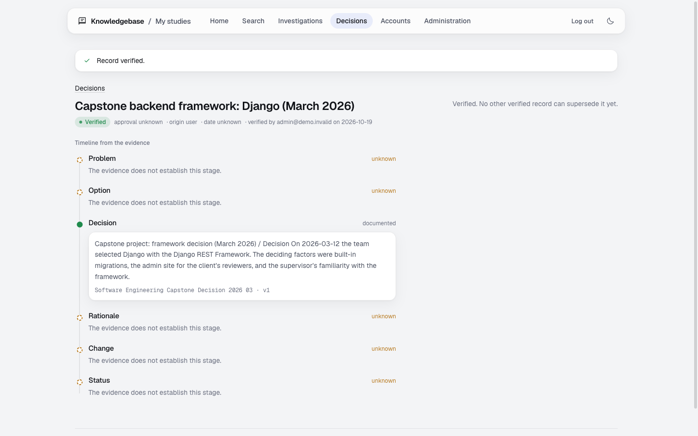 |

**Investigations, records, accounts, administration.**

| | |
|---|---|
| 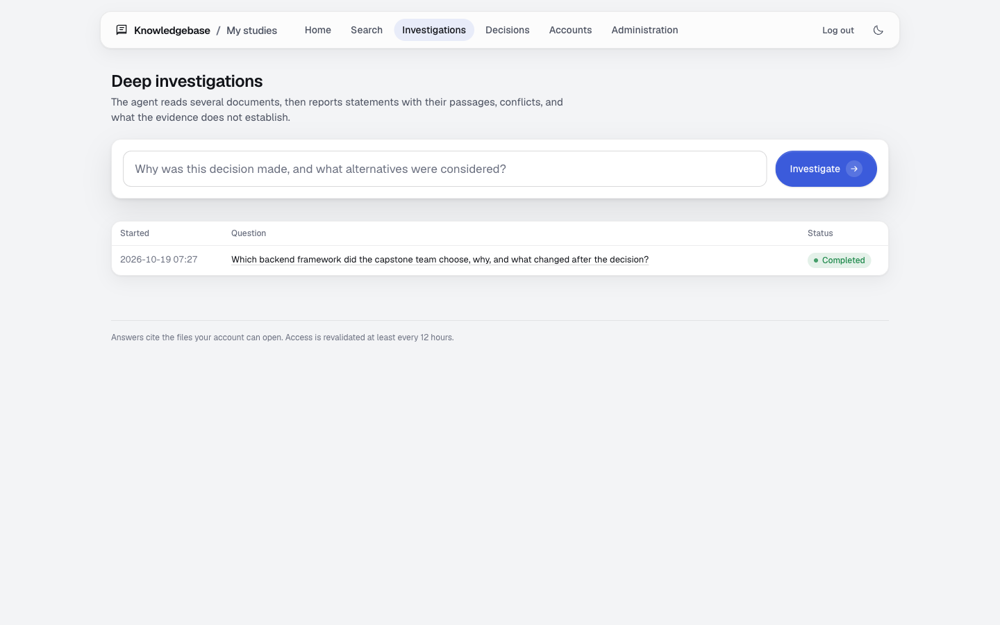 | 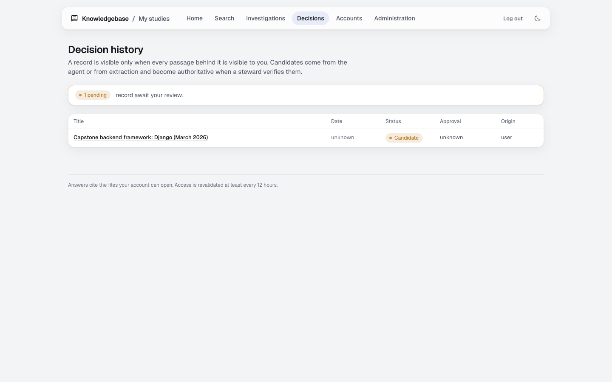 |
| 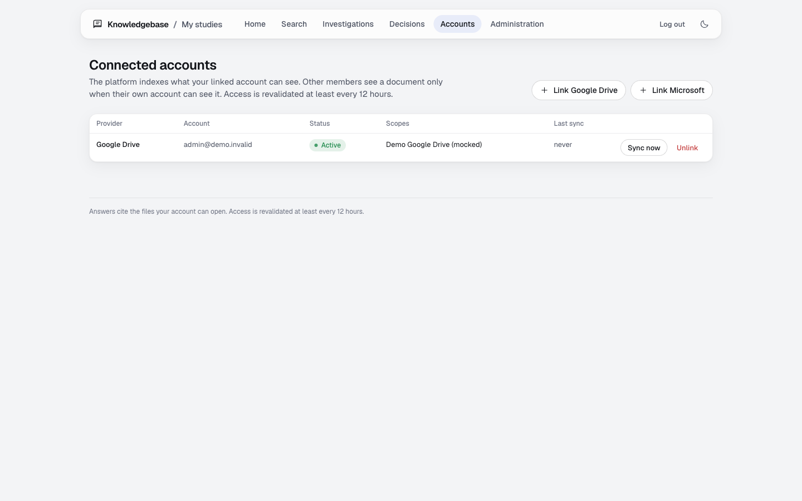 | 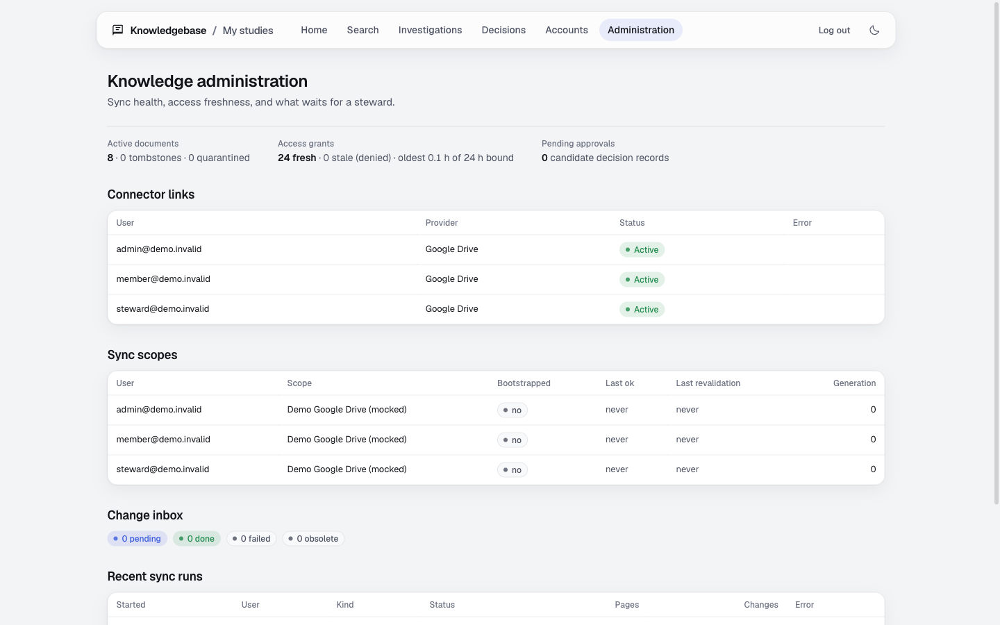 |

**Dark mode and phone width.**

| | |
|---|---|
| 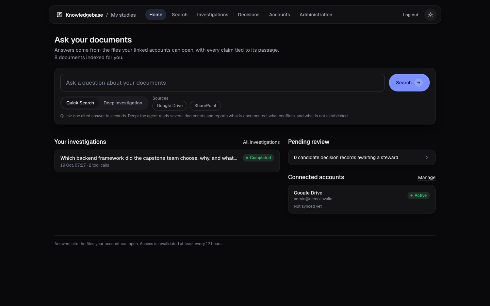 | 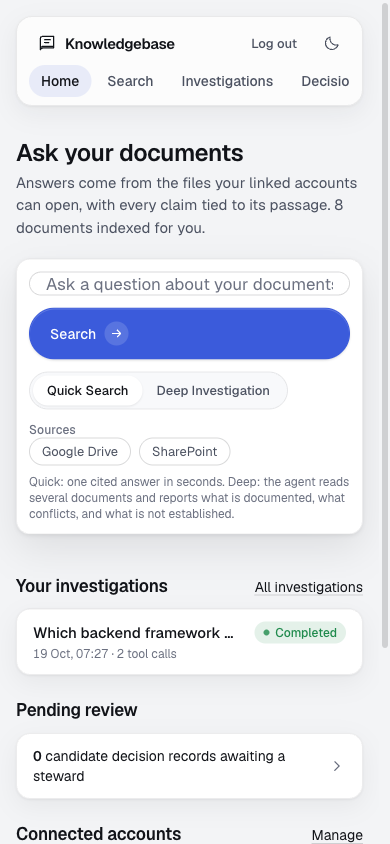 |

## The agent, seen from Hermes

Deep Investigation runs each question as one Hermes process with a generated configuration: one MCP server (this platform's knowledge server), a bearer token that lives only in that process, every other toolset disabled, memory off. The runner attests this configuration at startup by running a benign and an adversarial prompt against a self-check MCP server and refusing to serve if any non-knowledge tool is called.

Hermes ships a web dashboard. It is not part of the deployment, but it shows the agent at work with the same configuration: the MCP page lists the knowledge server with bearer auth, and the chat shows the tool calls.

| | |
|---|---|
| 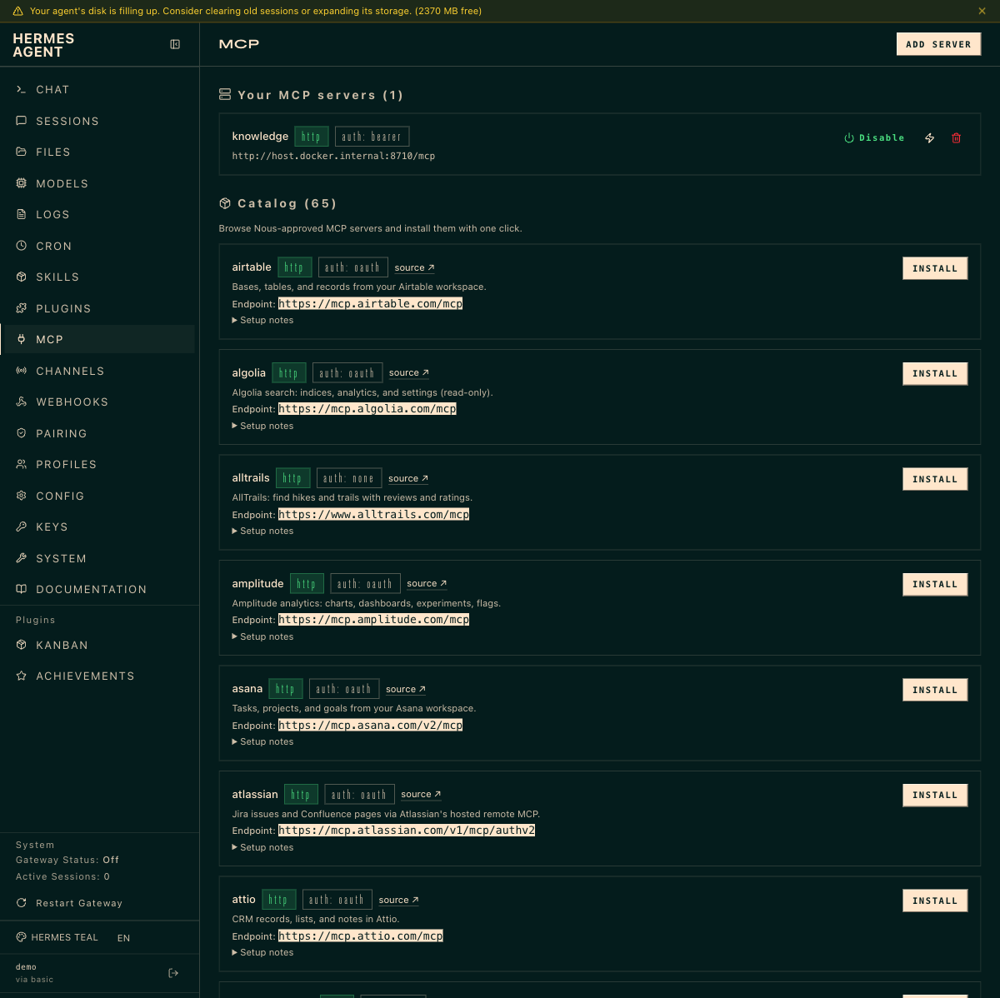 | 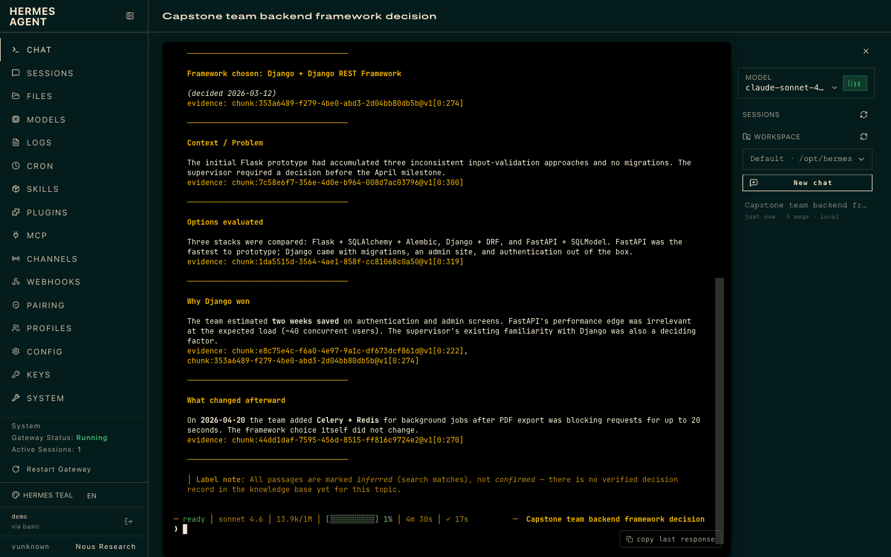 |

In the chat on the right the agent called `trace_decision` and `search_knowledge`, found nothing about the question in that account's drive, and said so instead of inventing an answer. The six tools it lists are the only ones it has.

To open the dashboard yourself, start it in the agent container with a password and the generated configuration pointing at the MCP server:

```bash
HASH=$(docker run --rm --entrypoint /opt/hermes/.venv/bin/python -w /opt/hermes kb-hermes-agent:dev \
  -c "from plugins.dashboard_auth.basic import hash_password; print(hash_password('choose-a-password'))")
docker compose --profile hermes run -d --no-deps --name kb-hermes-dash -p 127.0.0.1:9119:9119 \
  -v "$PWD/hermes/dashboard-config.yaml:/tmp/dash-src/config.yaml:ro" \
  -e HERMES_HOME=/tmp/dash -e KNOWLEDGE_MCP_TOKEN=<capability token of a running investigation> \
  -e HERMES_DASHBOARD_BASIC_AUTH_USERNAME=demo -e HERMES_DASHBOARD_BASIC_AUTH_PASSWORD_HASH="$HASH" \
  -e HERMES_DASHBOARD_BASIC_AUTH_SECRET="$(openssl rand -hex 24)" \
  --entrypoint sh hermes-agent -c 'mkdir -p /tmp/dash && cp /tmp/dash-src/config.yaml /tmp/dash/ && exec /opt/hermes/bin/hermes dashboard --host 0.0.0.0 --port 9119 --no-open'
```

`hermes/dashboard-config.yaml` is the configuration the runner generates per investigation (`hermes/runner/runs.py`, `render_config`), with the MCP URL of the development stack. The capability token must belong to a running investigation of the user whose documents the chat should see; the MCP server rejects anything else.

## Local development

```
cp .env.example .env            # fill SECRET_KEY, CONNECTOR_TOKEN_KEY (Fernet), RUNNER_SHARED_SECRET
make sync                       # uv sync (Python 3.14)
make up                         # postgres (127.0.0.1:5435) + redis (127.0.0.1:6381)
make migrate                    # as kb_migrator
make tailwind-build
make seed-demo                  # demo team with synthetic documents at /o/demo/
python manage.py seed_demo --corpus academic   # study corpus at /o/studies/
make run                        # web server; demo users: admin@/steward@/member@demo.invalid
make test                       # pytest on the compose Postgres
make eval                       # eval/results/<date>.md
```

One script starts the whole development stack with Deep Investigation on: `scripts/dev-up.sh`. It starts Postgres, Redis, migrations, demo data, the MCP server, the hermes-agent container, the Celery worker and beat, and the web server on http://localhost:8010. `scripts/dev-up.sh --stop` stops it. It needs `ANTHROPIC_API_KEY` in `.env` for the agent attestation.

Runtime processes use `DATABASE_URL` with the `kb_app` role; migrations and tests use `MIGRATOR_DATABASE_URL` (the Makefile does this).

## Connectors

**Google Drive.** Create an OAuth web client in Google Cloud with the Drive API enabled, scope `drive.readonly`, redirect URI `http://localhost:8010/connectors/google/callback/` for development (`https://<host>/connectors/google/callback/` in production). Put the client id and secret in `.env` as `GOOGLE_CLIENT_ID` and `GOOGLE_CLIENT_SECRET`. A Testing-mode consent screen works for the accounts you list as test users.

**SharePoint and OneDrive.** Register an app in Entra with platform Web, redirect URI `http://localhost:8010/connectors/microsoft/callback/`, delegated Microsoft Graph permissions `Files.Read.All` and, for work or school accounts, `Sites.Read.All`. Put `MICROSOFT_CLIENT_ID`, `MICROSOFT_CLIENT_SECRET`, and `MICROSOFT_TENANT` (`organizations`, `consumers`, or `common`) in `.env`. With `consumers` or `common` the app asks only for `Files.Read.All`, because a personal account has no SharePoint permission.

A work or school tenant can block user consent for third-party apps. In that case the consent page shows an "approval required" message, and an administrator of that tenant must grant the app in Entra before anyone can link. My university tenant does this, so the Graph connector remains verified against mocked API responses only (`connectors/tests/`).

Each member links their own account; the platform indexes what that account can see, and other members see a document only when their own account can see it.

## Deep Investigation (Hermes)

```
make hermes-build               # builds hermes-base:v0.22.1 from the pinned tag, then the service image
docker compose --profile hermes up -d hermes-agent
make mcp                        # knowledge MCP server on :8710 (compose service knowledge-mcp in production)
make hermes-spike               # CLI contract checks
```

Set `HERMES_ENABLED=True`, `HERMES_MODEL`, the provider key named by `HERMES_PROVIDER_API_KEY_ENV`, `RUNNER_SHARED_SECRET`, `RUNNER_URL`, `KNOWLEDGE_MCP_URL`. Details, the live attestation results, and troubleshooting: `HERMES_INTEGRATION.md`.

## Production

`docker-compose.prod.yml` + `Caddyfile.example`. Only Caddy publishes ports. `web` migrates on start with `MIGRATOR_DATABASE_URL`; `worker`, `beat`, `knowledge-mcp` run as `kb_app`. Resource limits, health checks and restart policies are in the compose file. Set `DEBUG=False`, real `ALLOWED_HOSTS`/`CSRF_TRUSTED_ORIGINS`, and strong `POSTGRES_PASSWORD`, `KB_MIGRATOR_PASSWORD`, `KB_APP_PASSWORD`.

### Backup and recovery

- Postgres: `docker compose -f docker-compose.prod.yml exec postgres pg_dump -U kb -Fc kb > backup.dump`; restore with `pg_restore -U kb -d kb --clean --if-exists backup.dump`. Roles are created by `scripts/postgres-init/` on an empty volume; on restore into a fresh volume run the init first, then `pg_restore`; the dump preserves owners (`kb_migrator`).
- Secrets live only in `.env` (never in the image: `.dockerignore`). Back up `.env` separately and rotate `CONNECTOR_TOKEN_KEY` by re-linking accounts.
- Redis holds queue and rate-limit state only; loss means pending tasks are re-enqueued by the beat scheduler and the reaper.
- Hermes data volume (`kb-hermes-data`) holds only transient run directories and terminal records; it needs no backup.

## Metrics

`GET /metrics` with `Authorization: Bearer <METRICS_TOKEN>` on the internal network.

## Documents

`ARCHITECTURE.md`, `SECURITY.md`, `HERMES_INTEGRATION.md`, `IMPLEMENTATION_STATUS.md`, `DECISIONS.md`, `CONTEXT.md`, `PRODUCT.md`, `DESIGN.md`, `PLAN.md`, `PLAN-REVIEW-LOG.md`.
